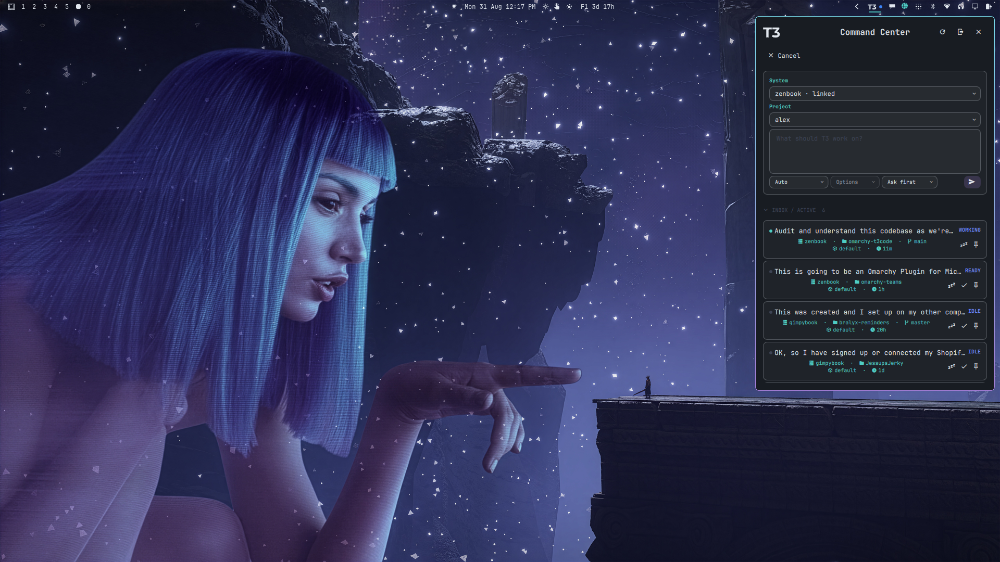
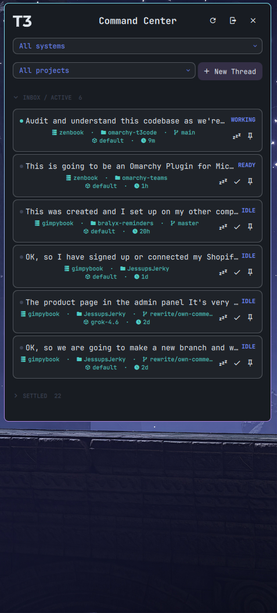
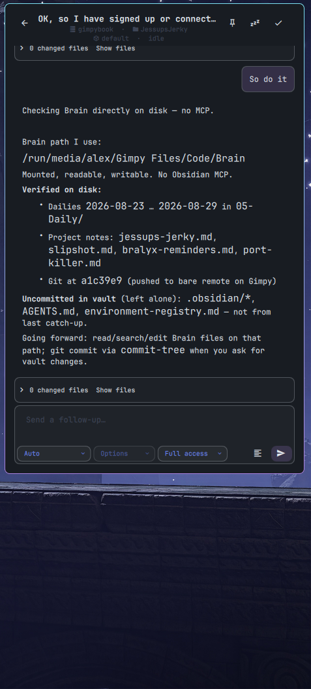
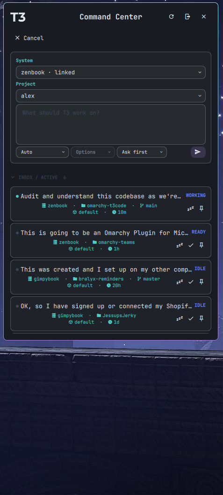
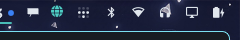

# T3 Command Center

Compact native [Omarchy](https://omarchy.org/) / Quickshell client for
[T3 Code](https://t3.gg/) — Inbox and threads without the full desktop app.

Published by **Bralyx Digital** as `bralyx.t3code`.



## Screenshots

| Inbox | Thread | New thread |
| --- | --- | --- |
|  |  |  |

Bar widget (T3 mark + status color):



## What it does

- Native Clerk browser sign-in with T3's `t3-relay` JWT, loopback callback
  handoff, and automatic Inbox summon
- Merged Inbox across linked systems, with system and project filters
- Streamed threads, approvals, user input, screenshot paste, lifecycle
  commands (settle / snooze / pin), and model / runtime controls
- One typed TypeScript bridge as a shell child; QML is presentation only —
  no embedded browser, terminal, editor, or Git UI

Works with **your linked T3 environments** over Relay. You do not need a
specific T3 Code desktop version installed on this machine — sign in with the
same T3 account you use elsewhere and the client talks to whatever environments
you have already connected. Optional operations follow each environment's
advertised capabilities.

## Install

```bash
omarchy plugin add https://github.com/GimpyHand/omarchy-t3code.git --enable
```

Omarchy warns that plugins run unsandboxed, clones this repo, validates the
manifest, and enables the plugin. No Node or pnpm needed at runtime. `--enable`
asks which bar section to use, defaulting to the right section.

```bash
omarchy plugin update bralyx.t3code                     # newer release later
omarchy bar move bralyx.t3code --section right --index 0 # move the widget
```

Or use a release archive:

```bash
tar -xzf omarchy-t3code-plugin.tar.gz
./install
```

Click the T3 mark → **Sign in with T3 Connect**. The browser callback returns
you to Inbox.

## Requirements

- A T3 account with at least one linked environment reachable through Relay
- Omarchy 4.0+ (x86-64) with Quickshell plugins
- Secret Service and `secret-tool` (for the Clerk session and DPoP identity)
- `wl-paste`, `xdg-open`, `xdg-mime`, `gzip`, `sha256sum`, graphical browser

The tools above ship with Omarchy's base packages (`libsecret`, `wl-clipboard`,
`xdg-utils`, `gzip`, `coreutils`), so a standard install needs nothing extra.
The browser is used only for the one-time sign-in, and `python3` is used for the
NDJSON line relay when present — the launcher runs the bridge directly without
it.

Other Linux arches can build a native bridge from source.

## Uninstall

```bash
omarchy plugin remove bralyx.t3code
```

That removes the checkout and its bar widget, but leaves the Secret Service
entries. To clear the stored Clerk client token, callback secret, OAuth token,
and DPoP key as well:

```bash
for item in t3-connect-clerk-client t3-connect-oauth \
  t3-connect-native-callback relay-dpop-proof-key; do
  secret-tool clear application bralyx.t3code item "$item"
done
```

Release archives still ship the `./uninstall` helper, where `--keep-secrets`
retains the Clerk session and DPoP identity. From a source checkout, use
`pnpm remove:plugin`.

## Development

```bash
pnpm check          # validate + typecheck + tests + QML + build
pnpm deploy:plugin  # build and copy into ~/.config/omarchy/plugins/
```

See [CONTRIBUTING.md](CONTRIBUTING.md), [ARCHITECTURE.md](ARCHITECTURE.md),
[SECURITY.md](SECURITY.md), and [docs/ACCEPTANCE.md](docs/ACCEPTANCE.md).

## License

MIT. Third-party notices and the Node runtime inventory live in
[THIRD_PARTY_NOTICES.md](THIRD_PARTY_NOTICES.md) and [licenses/](licenses/).
